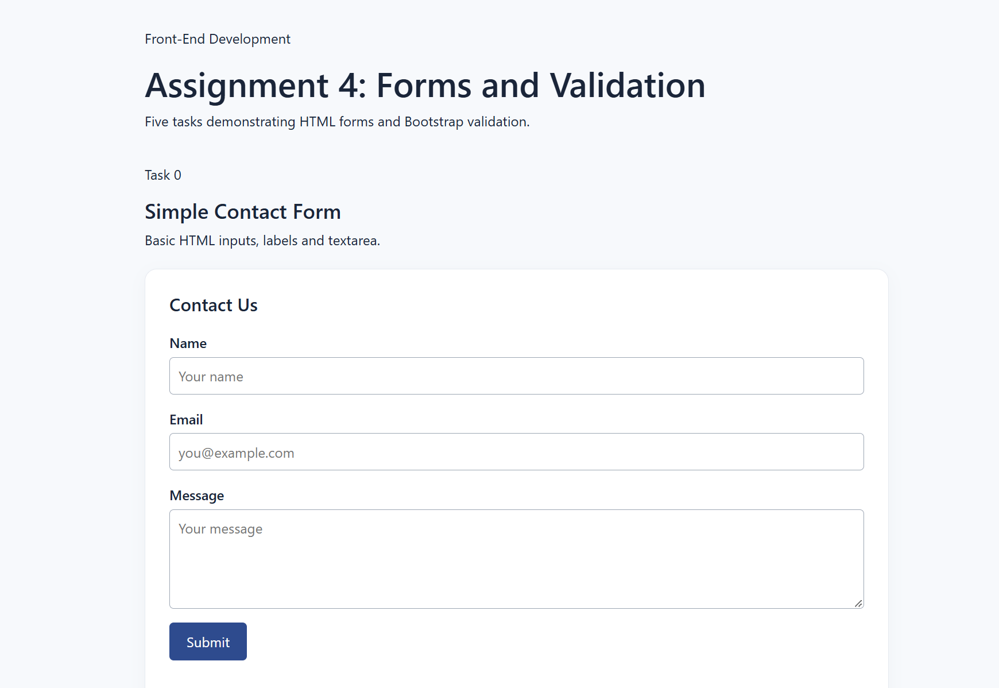
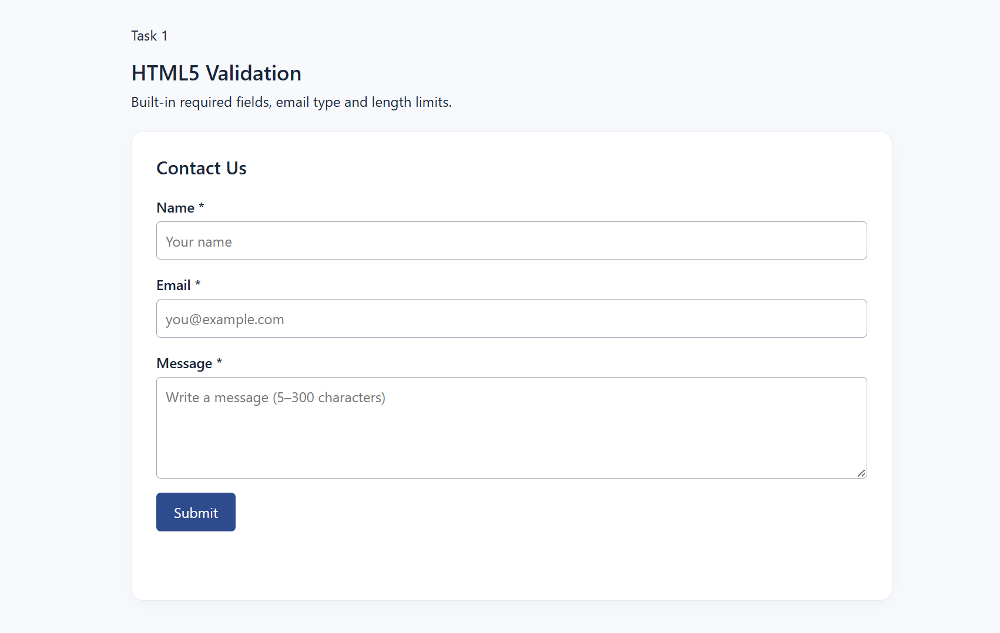
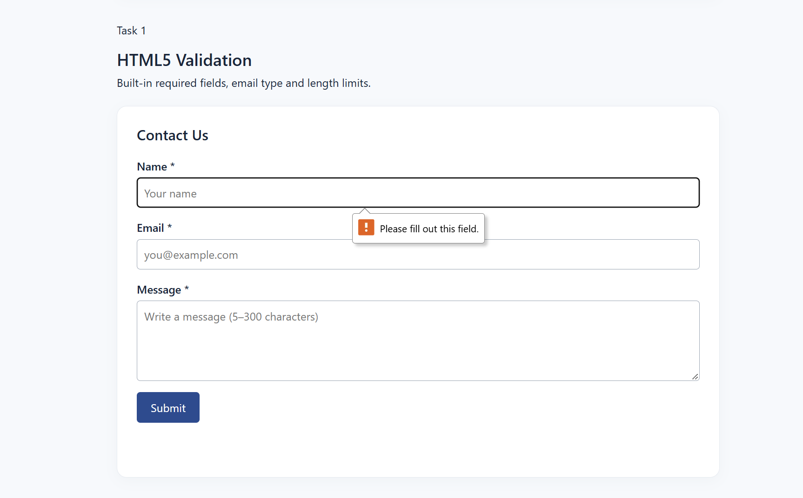
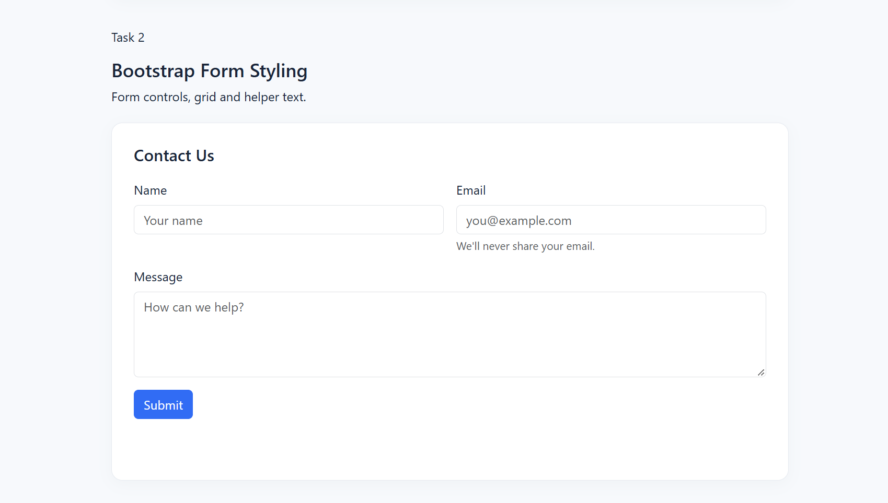
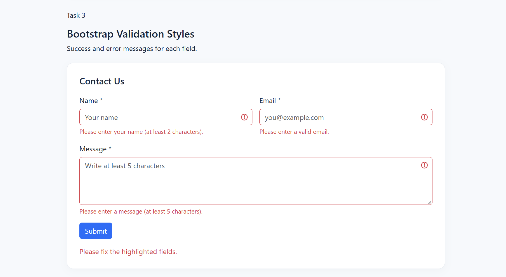
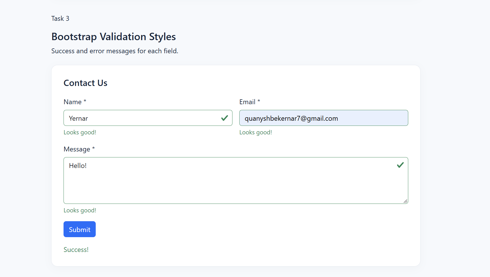
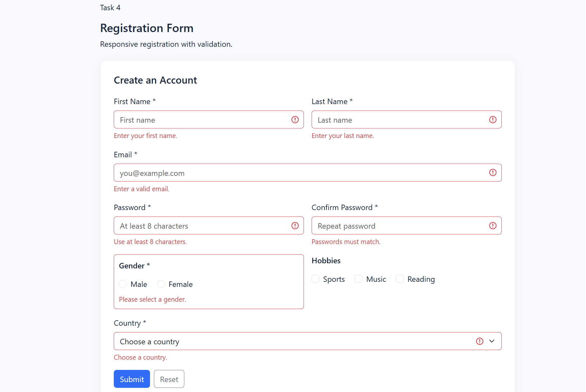
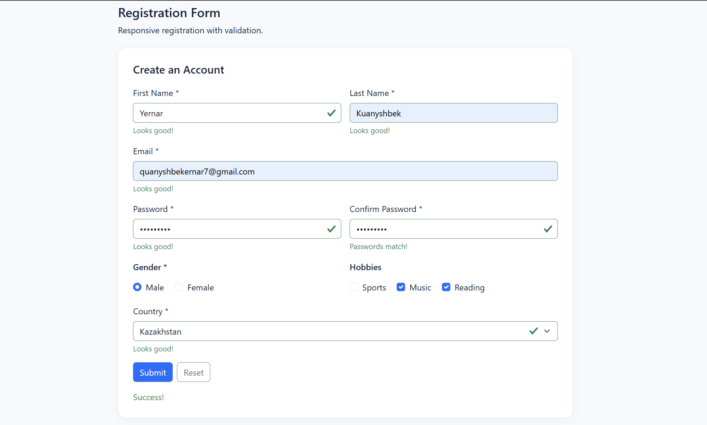
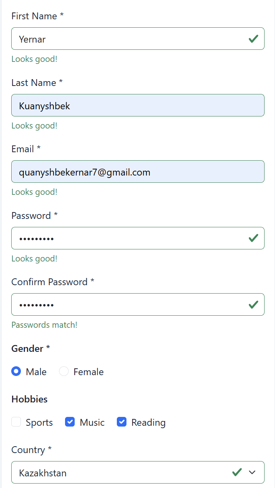

# Assignment 4 — Forms and Validation
Yernar Kuanyshbek

A small frontend project containing all five tasks (Task 0–4) on a single page. Built with HTML5, Bootstrap 5 and JavaScript. CSS and JavaScript are stored in separate files.

## Part 1 — Basic HTML Forms

### Task 0: Simple Contact Form
A basic contact form with Name, Email, Message, Submit button, and matching labels.

### Task 1: Form with HTML5 Validation
The contact form uses required, type="email", minlength, and maxlength. Built-in browser validation prevents submitting missing or invalid data.

Example of browser validation:

## Part 2 — Bootstrap Forms

### Task 2: Bootstrap Form Styling
The contact form uses Bootstrap's form-control, form-label, btn, responsive grid classes, placeholders, and helper text.

### Task 3: Bootstrap Validation Styles
JavaScript applies is-valid and is-invalid based on HTML5 validation. Bootstrap displays valid-feedback and invalid-feedback below inputs.

Invalid fields:

Valid fields:

## Part 3 — Advanced Form Project

### Task 4: Registration Form
A responsive registration form with First Name, Last Name, Email, Password, Confirm Password, Gender (radio buttons), Hobbies (checkboxes), Country (select), Submit, and Reset buttons. HTML5 validation checks required fields and password length; JavaScript additionally checks whether both passwords match.

Invalid submission:

Valid submission:

Mobile layout:

## Work Process Summary

1. Created a simple contact form using HTML inputs, labels, and a textarea.
2. Added HTML5 validation to check required fields, email format, and input length.
3. Used Bootstrap to improve the appearance and responsiveness of the forms.
4. Implemented JavaScript validation with visual feedback for correct and incorrect inputs.
5. Developed a registration form with password confirmation, radio buttons, checkboxes, and a dropdown menu.
6. Tested the forms with different inputs and checked the layout on smaller screens.

## Conclusion
This assignment helped me understand how HTML forms, Bootstrap, CSS, and JavaScript work together. I learned how to create different form elements, validate user input, display feedback messages, and make forms responsive.
The most interesting part was implementing JavaScript validation because it made the forms more interactive.
All five tasks are included on one page. The forms demonstrate client-side functionality without sending data to a server.
